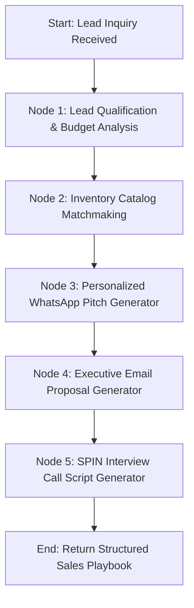

# System Architecture: BK Group Digital Platform

Comprehensive technical architecture for the unified **BK Motors**, **BK Properties**, and **LangGraph AI Engine** monorepo.

---

## 1. High-Level Architecture Diagram

```
                              [ HTTPS Requests ]
                                      │
                                      ▼
                      ┌───────────────────────────────┐
                      │     Caddy 2 Reverse Proxy     │
                      │  (Automated SSL Certificates) │
                      └───────────────┬───────────────┘
                                      │
     ┌──────────────────┬─────────────┴──────┬──────────────────┬─────────────────┐
     │                  │                    │                  │                 │
     ▼                  ▼                    ▼                  ▼                 ▼
┌──────────────┐ ┌──────────────┐   ┌─────────────────┐ ┌──────────────┐ ┌───────────────┐
│  BK Motors   │ │BK Properties │   │Strapi CMS (API) │ │Motors Admin  │ │Properties Admin│
│  (Port 80)   │ │  (Port 80)   │   │  (Port 1337)    │ │ (/admin)     │ │ (/admin)       │
└──────┬───────┘ └──────┬───────┘   └────────┬────────┘ └──────────────┘ └───────────────┘
       │                │                    ▲
       └────────────────┼────────────────────┤
                        ▼                    ▼
             ┌─────────────────────────────────────────┐
             │       LangGraph AI Engine (FastAPI)     │
             │                (Port 8000)              │
             └────────────────────┬────────────────────┘
                                  │
                  ┌───────────────┴───────────────┐
                  ▼                               ▼
       ┌─────────────────────┐         ┌─────────────────────┐
       │   NVIDIA NIM LLM    │         │  OpenRouter (Backup)│
       │ (Llama 3.2 11B Vis) │         │ (Llama 3.2 11B Vis) │
       └─────────────────────┘         └─────────────────────┘
```

---

## 2. Monorepo Structural Layout

```plaintext
BK-Motors-Property/
├── frontend/                     # React 19 + TypeScript + Vite + MUI 5
│   ├── src/
│   │   ├── apps/
│   │   │   ├── motors/           # Automotive Dealership Portal
│   │   │   │   ├── components/   # VehicleCard, CarFilterBar, FinancingCalculator
│   │   │   │   ├── pages/        # Inventory, Detail, Consignment SellCar, Contact
│   │   │   │   └── theme.ts      # Motifiti-inspired Amber (#D97706) & Slate (#0F172A)
│   │   │   └── properties/       # Luxury Real Estate Portal
│   │   │       ├── components/   # PropertyCard, PropertyFilterBar, MortgageCalculator
│   │   │       ├── pages/        # Buy/Rent Listings, Land & Plots, ListProperty, Detail
│   │   │       └── theme.ts      # Emerald Teal (#0D9488) & Dark Navy (#064E3B)
│   │   └── shared/               # Shared cross-domain component libraries
│   │       ├── components/       # DealerDocumentVault, TransactionTracker, AiAssistantWidget,
│   │       │                     # AiOutreachDrawer, AuthModal, ClientDashboard, ShortlistDrawer
│   │       ├── context/          # AuthContext, CurrencyContext (KES/USD), FavoritesContext
│   │       ├── services/         # Strapi REST client, JWT Auth provider, mock fallback catalog
│   │       ├── types/            # TypeScript schemas for Vehicles, Properties, Docs, Ledger
│   │       └── utils/            # Kenyan banking loan mathematics & currency formatters
│   ├── Dockerfile.motors         # Nginx container for BK Motors
│   ├── Dockerfile.properties     # Nginx container for BK Properties
│   └── vite.config.ts            # Dual build target pipeline (--mode motors / --mode properties)
│
├── cms/                          # Strapi Headless CMS (Node 22 / v4)
│   ├── src/api/
│   │   ├── car/                  # 150-pt inspection, specifications, pricing, gallery
│   │   ├── property/             # Acreage, title deeds, zoning, topography, soil, rental/sale
│   │   └── inquiry/              # Test drive bookings, tour viewings, consignments
│   ├── config/                   # Multi-environment database (SQLite / MySQL) & JWT secrets
│   └── server.js                 # cPanel Phusion Passenger entrypoint
│
├── ai-service/                   # LangGraph AI Engine (Python 3.10+ / FastAPI)
│   ├── app/
│   │   ├── graphs/
│   │   │   ├── outreach_graph.py # Autonomous multi-node lead qualification & outreach generator
│   │   │   └── concierge_graph.py# Client-facing interactive automotive/real estate AI assistant
│   │   ├── config.py             # NVIDIA NIM & OpenRouter configuration
│   │   └── main.py               # FastAPI REST endpoints (/health, /api/chat, /api/outreach/generate)
│   ├── Dockerfile                # Python container
│   └── requirements.txt          # LangGraph, LangChain, FastAPI, Uvicorn, Pydantic
│
├── docker-compose.yml            # Multi-service container orchestration
├── CPANEL_DEPLOYMENT_GUIDE.md    # Traditional cPanel / Apache deployment manual
├── ARCHITECTURE.md               # This technical architecture document
└── README.md                     # Project overview and quickstart manual
```

---

## 3. Data Flow & Security Models

### 3.1 Authentication & Authorization
- **Public Visitors**: Can browse all listings, run bank loan & mortgage calculations, filter by make/body/tenure/soil, and switch display currency (KES / USD).
- **Client Authentication Gate**:
  - Submitting a car for consignment (`/sell`) or listing a property (`/list`) requires mandatory authentication.
  - Visitors without an active session are prompted by an authenticated security modal explaining the verified NTSA logbook and Ministry of Lands title deed verification procedures.
  - Inquiries and consignments are automatically tied to the authenticated user ID (`users-permissions` plugin).
- **Role-Based Profiles**:
  - `Admin`: Full CMS control across all collections.
  - `Sales Agent`: Assigned leads, generates AI outreach drafts, verifies documents.
  - `Client / Dealer`: Access to private Client Dashboard, Dealer Document Vault, and Escrow Ledger.

### 3.2 Dealer & Seller Document Vault
1. **Multi-Angle Photos**: High-resolution upload gallery for vehicles and plots.
2. **NTSA Logbooks & Title Deeds**: Upload and management of vehicle logbooks, certificates of title, and registry search certificates.
3. **Consignment / Sales Agreement Generator**: Auto-generates formal Deed of Sale with customizable seller payout terms and dealership commission percentages.
4. **AI Document Verification Engine**:
   - Assesses document legibility and completeness.
   - Cross-checks Vehicle Identification Number (VIN) / chassis format against international ISO 3779 standards.
   - Verifies NTSA TIMS transfer compliance and Ministry of Lands parcel registry format.

### 3.3 Financial Escrow & Transaction Ledger
- Tracks complete monetary lifecycle:
  1. `Booking Deposit` (M-PESA Paybill / Bank transfer)
  2. `Bank Escrow Hold` (KCB / Stanbic Bank escrow account)
  3. `Asset Finance Disbursement` (Commercial bank release)
  4. `Seller Payout & Commission Release`
- Interactive printable/downloadable official receipts with cryptographic reference numbers.

---

## 4. LangGraph Autonomous AI Pipelines

### 4.1 Sales Outreach Graph (`outreach_graph.py`)



1. **Lead Qualification**: Analyzes user intent, estimated budget range, financing eligibility, and urgency.
2. **Catalog Matchmaking**: Retrieves matching vehicles or properties from the Strapi catalog.
3. **WhatsApp Pitch Generator**: Crafts concise, respectful messages formatted with Kenyan business etiquette.
4. **Email Proposal Generator**: Produces complete executive proposals highlighting technical specs, 150-pt inspection results, or title deed guarantees.
5. **SPIN Selling Script Generator**: Generates tailored sales call scripts for sales reps (Situation, Problem, Implication, Need-Payoff questions).

### 4.2 Interactive Sales Concierge (`concierge_graph.py`)
- Live floating widget on both portals.
- Context-aware: knows whether the client is on BK Motors (discussing mileage, transmission, import year, bank financing) or BK Properties (discussing title deeds, borehole water, rental yield, freehold vs leasehold).
- Built-in loan calculator tool factoring in standard 13% APR commercial banking rates in Kenya.

---

## 5. Deployment Architecture

### 5.1 Docker + Caddy Reverse Proxy
- All services run on an internal Docker bridge network (`caddy_default`).
- Caddy automatically provisions and renews Let's Encrypt / ZeroSSL TLS certificates for all subdomains.
- Frontends are served via ultra-lightweight Alpine Nginx containers (`nginx:alpine`).
- Strapi runs on Node 22 slim.
- AI service runs on Python 3.10 slim via Uvicorn ASGI.

### 5.2 Traditional cPanel / Apache Alternative
- `npm run build:all` creates isolated static distributions (`dist/motors` and `dist/properties`).
- Each distribution contains `.htaccess` configured for HTML5 History API URL rewriting.
- Strapi runs under cPanel Phusion Passenger via `cms/server.js`.
